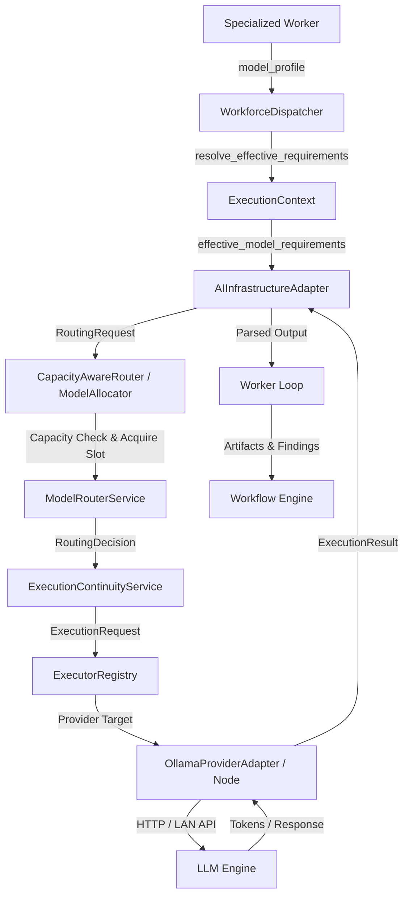

# Forensic Audit Report: 23-Worker AI Workforce & Model-Routing Architecture

**Document ID:** `23_WORKER_AI_BINDING_FORENSIC_AUDIT.md`  
**Date:** September 19, 2026  
**Auditor:** Antigravity Forensic Audit Subsystem  
**Scope:** Static and Runtime Forensic Audit of `packages/workforce`, `packages/execution`, `packages/ai_infrastructure`, `packages/modernization`, `packages/composition`, and related test suites.  
**Mode:** FORENSIC AUDIT ONLY — NO IMPLEMENTATION CHANGES PERFORMED.

---

## 1. Executive Verdict

AutoForge's 23-worker workforce architecture has a well-designed declarative foundation, but **its runtime model-backed execution is substantially incomplete and fragmented across architectural seams**.

1. **Are all 23 true AI agents today?**
   **No.** Only **4 workers** have end-to-end loops that invoke AI infrastructure and process LLM responses.
2. **How many are genuinely model-backed?**
   **4 workers** (`ResearchEngineer`, `ArchitectureEngineer`, `PlanningEngineer`, `BackendEngineer`).
3. **How many are AI-capable but incompletely bound?**
   **17 workers** (10 Greenfield workers fall back to the generic `EngineeringLoop` without role-specialized prompts or tooling; 7 Legacy workers execute hardcoded markdown/JSON stubs in `loops.py` that never invoke an LLM).
4. **How many are deterministic by design?**
   **2 workers** (`LegacySystemsResearchEngineer` executes AST/parser discovery via `get_analyzer_for_file`; `BusinessRulesAnalyst` performs substring regex scans for `IF` and `COMPUTE`).
5. **Is worker-specific model routing actually operational?**
   **Partially.** `WorkforceDispatcher` attaches `effective_model_requirements` to `ExecutionContext`, and `AIInfrastructureAdapter` maps capabilities to `ModelRouterService`. However:
   - **`CapacityAwareRouter` and `ModelCapacityManager` are completely bypassed** during actual execution; `AIInfrastructureAdapter` talks directly to `ModelRouterService`, ignoring node concurrency limits.
   - Non-capability preferences (`quality_priority`, `latency_priority`, `cost_priority`, `reliability_minimum`) are **dropped** during request building in `AIInfrastructureAdapter._build_routing_request()`.
6. **Is the architecture fundamentally sound?**
   **Yes.** The decoupled design (Worker Profile → Effective Requirements → Capacity Router → Model Router → Provider Adapter) is clean, model-agnostic, and correct. The problem is not the architecture; the problem is incomplete wiring, stubbed execution loops, and a disconnected legacy subsystem.
7. **What is the exact missing piece?**
   - Missing specialized loops for 10 Greenfield workers (they fall back to generic coding).
   - Stubbed execution loops for 7 Legacy workers (they emit hardcoded strings).
   - Direct Ollama hardcoding in `packages/modernization` (`G3LLMIntegration`), bypassing the canonical workforce and model router entirely.
   - Disconnection of `CapacityAwareRouter` from `AIInfrastructureAdapter`.

---

## 2. Exact 23-Worker Inventory

The repository contains exactly **23 specialized worker classes** declared in `packages/workforce/src/autoforge_workforce/workers.py` and registered into `WORKER_REGISTRY` (`registry.py`).

| # | Worker Class | Worker Type Key | Category | Declared Loop Type | Actual Loop Class | Loop AI Call | Classification |
|---|---|---|---|---|---|---|---|
| 1 | `ResearchEngineer` | `research_engineer` | Greenfield | `research` | `ResearchLoop` | `_ai.generate_plan` | **A** (True Model-Backed) |
| 2 | `ArchitectureEngineer` | `architecture_engineer` | Greenfield | `architecture` | `ArchitectureLoop` | `_ai.generate_plan` | **A** (True Model-Backed) |
| 3 | `PlanningEngineer` | `planning_engineer` | Greenfield | `planning` | `PlanningLoop` | `_ai.generate_plan` | **A** (True Model-Backed) |
| 4 | `UIDesigner` | `ui_designer` | Greenfield | `ui_design` | `EngineeringLoop` (fallback) | Generic code plan/impl | **B** (Incompletely Bound) |
| 5 | `BackendEngineer` | `backend_engineer` | Greenfield | `backend` | `EngineeringLoop` (fallback) | `_ai.generate_implementation` | **A** (True Model-Backed) |
| 6 | `FrontendEngineer` | `frontend_engineer` | Greenfield | `frontend` | `EngineeringLoop` (fallback) | Generic code plan/impl | **B** (Incompletely Bound) |
| 7 | `DatabaseEngineer` | `database_engineer` | Greenfield | `database` | `EngineeringLoop` (fallback) | Generic code plan/impl | **B** (Incompletely Bound) |
| 8 | `MLEngineer` | `ml_engineer` | Greenfield | `ml` | `EngineeringLoop` (fallback) | Generic code plan/impl | **B** (Incompletely Bound) |
| 9 | `InfrastructureEngineer` | `infrastructure_engineer` | Greenfield | `infrastructure` | `EngineeringLoop` (fallback) | Generic code plan/impl | **B** (Incompletely Bound) |
| 10 | `DevOpsEngineer` | `devops_engineer` | Greenfield | `devops` | `EngineeringLoop` (fallback) | Generic code plan/impl | **B** (Incompletely Bound) |
| 11 | `QAEngineer` | `qa_engineer` | Greenfield | `qa` | `EngineeringLoop` (fallback) | Generic code plan/impl | **B** (Incompletely Bound) |
| 12 | `SecurityEngineer` | `security_engineer` | Greenfield | `security` | `EngineeringLoop` (fallback) | Generic code plan/impl | **B** (Incompletely Bound) |
| 13 | `PerformanceEngineer` | `performance_engineer` | Greenfield | `performance` | `EngineeringLoop` (fallback) | Generic code plan/impl | **B** (Incompletely Bound) |
| 14 | `DocumentationEngineer` | `documentation_engineer` | Greenfield | `documentation` | `EngineeringLoop` (fallback) | Generic code plan/impl | **B** (Incompletely Bound) |
| 15 | `LegacySystemsResearchEngineer` | `legacy_systems_research_engineer` | Legacy | `legacy_discovery` | `LegacyDiscoveryLoop` | None (AST parser only) | **C** (Deterministic by Design) |
| 16 | `LegacyCodeArchaeologist` | `legacy_code_archaeologist` | Legacy | `legacy_code_archaeology` | `LegacyCodeArchaeologyLoop` | None (Hardcoded stub) | **B** (Incompletely Bound / Stub) |
| 17 | `LegacyArchitectureAnalyst` | `legacy_architecture_analyst` | Legacy | `legacy_architecture_reconstruction` | `LegacyArchitectureReconstructionLoop` | None (Hardcoded stub) | **B** (Incompletely Bound / Stub) |
| 18 | `LegacyDataEngineer` | `legacy_data_engineer` | Legacy | `legacy_data_analysis` | `LegacyDataAnalysisLoop` | None (Hardcoded stub) | **B** (Incompletely Bound / Stub) |
| 19 | `LegacyIntegrationEngineer` | `legacy_integration_engineer` | Legacy | `legacy_integration_analysis` | `LegacyIntegrationAnalysisLoop` | None (Hardcoded stub) | **B** (Incompletely Bound / Stub) |
| 20 | `BusinessRulesAnalyst` | `business_rules_analyst` | Legacy | `business_rule_extraction` | `BusinessRuleExtractionLoop` | None (Regex scan only) | **C** (Deterministic by Design) |
| 21 | `DependencyImpactAnalyst` | `dependency_impact_analyst` | Legacy | `dependency_impact_analysis` | `DependencyImpactAnalysisLoop` | None (Hardcoded stub) | **B** (Incompletely Bound / Stub) |
| 22 | `ModernizationArchitect` | `modernization_architect` | Legacy | `modernization_architecture` | `ModernizationArchitectureLoop` | None (Hardcoded stub) | **B** (Incompletely Bound / Stub) |
| 23 | `MigrationEngineer` | `migration_engineer` | Legacy | `migration_planning` | `MigrationPlanningLoop` | None (Hardcoded stub) | **B** (Incompletely Bound / Stub) |

---

## 3. Runtime Trace

### The Intended Architectural Path


### The Actual Runtime Path (Forensic Findings)

1. **Task Submission:**
   A `TaskDefinition` enters `WorkforceDispatcher.dispatch_task()`.
2. **Worker Instantiation:**
   `WorkforceDispatcher.create_specialized_worker()` looks up `specialized_type` in `WORKER_REGISTRY` and instantiates the subclass (e.g. `BackendEngineer`).
3. **Requirement Resolution:**
   `resolve_effective_requirements(worker.model_profile, task_model_reqs)` combines worker policy with task requirements. This produces `EffectiveModelRequirements`.
4. **Context Creation:**
   `effective_reqs.to_dict()` is serialized into `ExecutionContext.effective_model_requirements`.
5. **Execution Invocation:**
   `worker.execute_task(context)` calls `loop_cls = get_loop_class(self.expertise.default_loop_type)` and runs `loop.run()`.
   - For `ResearchEngineer`, `ArchitectureEngineer`, `PlanningEngineer`: specialized loop calls `self._ai.generate_plan(context)`.
   - For `BackendEngineer`: falls back to `EngineeringLoop.run()`, which calls `self._ai.generate_plan()` and `self._ai.generate_implementation()`.
   - For the other 10 Greenfield workers: falls back to `EngineeringLoop.run()`, which prompts the model with generic backend engineering instructions.
   - For 7 Legacy workers: loop ignores `self._ai` completely and emits static hardcoded strings.
   - For 2 Legacy workers (`LegacySystemsResearchEngineer`, `BusinessRulesAnalyst`): loop executes deterministic parser/regex logic without LLM.
6. **Adapter Bridging (`AIInfrastructureAdapter`):**
   `generate_plan()` / `generate_implementation()` calls `_build_routing_request(context)`.
   - **Bypass 1 (`CapacityAwareRouter`):** `AIInfrastructureAdapter` holds a reference to `ModelRouterService`, NOT `CapacityAwareRouter`. It NEVER queries `ModelCapacityManager` and NEVER checks node slot saturation.
   - **Loss of Specificity:** `quality_priority`, `latency_priority`, and `reliability_minimum` are NOT passed to `RoutingRequest`. Only `required_capabilities`, `min_context_window_tokens`, and `allowed_deployment_modes` (privacy) are passed.
7. **Model Selection:**
   `ModelRouterService.route()` matches capabilities in `InMemoryCapabilityRegistry` and ranks models using `LocalFirstRoutingPolicy`.
   - For reasoning tasks: routes to `ornith-9b` on `local-m1`.
   - For coding tasks: routes to `qwen2.5-coder-7b` on `local-m1` (or `qwen2.5-coder-3b` on `local-hp` if targeted).
8. **Inference Execution:**
   `ExecutionContinuityService` or `ExecutorRegistry` executes `OllamaProviderAdapter.execute()`, which performs HTTP POST to Ollama (`/api/chat` or `/api/generate`).
9. **Return & Validation:**
   Response is parsed and returned to `AIInfrastructureAdapter`, which sets `last_execution_result`.
   The worker loop records artifacts and returns to `WorkforceDispatcher`.
10. **Silent Fallback Seam:**
    If `self._executor` or `self._router` is `None`, or if an exception occurs during inference:
    `AIInfrastructureAdapter` catches the exception and returns a **hardcoded fallback string** (`"Implementation plan for {task_name}: analyze requirements, inspect files, apply edits, and verify."`) or inspects `context.input_data` for pre-seeded files. Tests pass without any LLM invocation.

---

## 4. Model Binding Analysis

### Where Worker Specificity Is Preserved vs. Lost

```
WorkerModelProfile (Declared in workers.py)
   ├── worker_type               --> PRESERVED (Logged in telemetry)
   ├── required_capabilities     --> PRESERVED (Passed to RoutingRequest)
   ├── min_context_window_tokens --> PRESERVED (Passed to RoutingRequest)
   ├── privacy_policy            --> PRESERVED (Enforced as local_only)
   ├── quality_priority (1..5)   --> DROPPED in AIInfrastructureAdapter._build_routing_request
   ├── latency_priority          --> DROPPED in AIInfrastructureAdapter._build_routing_request
   ├── cost_priority             --> DROPPED in AIInfrastructureAdapter._build_routing_request
   ├── reliability_minimum       --> DROPPED in AIInfrastructureAdapter._build_routing_request
   └── fallback_policy           --> DROPPED in AIInfrastructureAdapter._build_routing_request
```

### Routing & Capacity Allocation Analysis
- **`ModelCapacityManager`**: Defined in `packages/workforce/src/autoforge_workforce/model_allocator.py`. Features thread-safe concurrency tracking, waiting queues (`asyncio.Event`), and node health tracking (`offline_nodes`).
- **`CapacityAwareRouter`**: Combines `ModelRouterService` and `ModelCapacityManager`. Correctly iterates candidate fallbacks when a node is busy.
- **The Disconnect**: Neither `build_ai_infrastructure` (`packages/composition/src/autoforge_composition/ai_infrastructure_wiring.py`) nor `build_engine.py` (`apps/api/src/autoforge_api/build_engine.py`) wires `CapacityAwareRouter` into the execution path. In `build_engine.py`, `self.capacity_router` is initialized on line 85 and **never called again**. In `composition_root.py`, `build_ai_infrastructure` only passes `ModelRouterService` to `ExecutionEngine`.

---

## 5. Legacy Modernization Integration

### Core Question: Does 18-G Use the 23-Worker Workforce?
**No. It is completely disconnected from the 23-worker workforce.**

Source code inspection of `packages/modernization` reveals:
1. **Zero References to Workforce:**
   `WorkforceDispatcher`, `WORKER_REGISTRY`, and `WorkforceWorker` are **never imported or referenced anywhere** in `packages/modernization`.
2. **Duplicate Autonomous Pipeline:**
   `packages/modernization/src/autoforge_modernization/composition/workflow.py` defines `DynamicCapabilityWorkflow`, which constructs its own pipeline:
   - `ProjectTechnologyDiscoveryEngine`
   - `TargetCapabilityDeriver`
   - `CapabilityGapAnalyzer`
   - `SemanticModelExtractor`
   - `GenericTransformationPlanner`
   - `GenericTargetArtifactGenerator`
   - `TargetToolchainVerifier`
   - `AutonomousTargetRepairCycle`
   - `AutonomousAcquisitionEngine`
3. **Direct Bypassing LLM Client:**
   `packages/modernization/src/autoforge_modernization/g3_llm.py` defines `G3LLMIntegration`. It directly connects to `http://127.0.0.1:11434` with a hardcoded model `qwen2.5-coder:7b-instruct-q3_K_M`. It does not use `ModelRouterService`, `CapacityAwareRouter`, `AIInfrastructureAdapter`, or `ExecutionContinuityService`.
4. **The 9 Legacy Workers are Orphant Stubs:**
   The 9 legacy workers registered in `autoforge_workforce` (`LegacySystemsResearchEngineer`, `LegacyCodeArchaeologist`, `LegacyArchitectureAnalyst`, `LegacyDataEngineer`, `LegacyIntegrationEngineer`, `BusinessRulesAnalyst`, `DependencyImpactAnalyst`, `ModernizationArchitect`, `MigrationEngineer`) are completely ignored by the modernization package. Their loops in `loops.py` simply return static mock strings.

---

## 6. Test Coverage Audit

| Test Suite | Location | What Is Actually Tested | False AI Illusion Risk |
|---|---|---|---|
| `test_workforce_core.py` | `packages/workforce/tests/` | Registry lookup, expertise matching, permission validation. | Low (unit tests on metadata). |
| `test_model_allocation.py` | `packages/workforce/tests/` | Static calls to `router.route_task()`; `test_workforce_dispatcher_end_to_end_dispatch` uses `AIInfrastructureAdapter()` with **no router and no executor**. | **HIGH**: E2E dispatch test passes because adapter silently returns hardcoded text and writes input files without calling any LLM. |
| `test_real_runtime_integration.py` | `packages/workforce/tests/` | Invokes `fake_ollama` mock HTTP client; tests `AIInfrastructureAdapter` recording result and observability telemetry. | Medium: Verifies telemetry propagation, but uses mocked HTTP double. |
| `test_e2e_pipelines.py` | `packages/workforce/tests/` | Runs Greenfield & Legacy workflows via `build_autoforge_system()`. | **HIGH**: All 5 legacy tasks pass instantly because their loops return hardcoded markdown strings in `loops.py`. |
| `test_legacy_archaeology.py` | `packages/workforce/tests/` | Verifies static analyzers on COBOL/Java files. | Low (deterministic analysis). |
| `benchmark_distributed_inference.py` | `packages/modernization/evidence/` | Directly issues raw `httpx.post` calls to M1 (`127.0.0.1:11434`) and HP (`192.168.1.104:11434`). | High: Bypasses the platform, router, and workforce completely. |

---

## 7. Architecture Gap Matrix

| Area | Expected | Actual | Gap | Severity |
|---|---|---|---|---|
| **Workforce Model Routing** | Worker profile drives `CapacityAwareRouter` → `ModelRouterService` | `CapacityAwareRouter` is bypassed; `AIInfrastructureAdapter` talks directly to `ModelRouterService` | Node capacity & concurrency limits are not enforced during real execution | **High** |
| **Worker Specificity** | Profile attributes (`quality_priority`, `latency_priority`, `reliability`) influence model ranking | Dropped in `_build_routing_request()`; only capabilities and context size survive | High-quality tasks (e.g. tier 5 for `ModernizationArchitect`) cannot express priority to the router | **Medium** |
| **Greenfield Worker Loops** | 14 workers each have specialized execution loops and domain-specific prompts | Only 3 specialized loops (`research`, `architecture`, `planning`); 11 workers fall back to generic `EngineeringLoop` | UI Designer, QA, Security, Database, DevOps act as generic backend coders | **High** |
| **Legacy Worker Loops** | 9 legacy workers invoke AI infrastructure for archaeology, reconstruction, rules, planning | 7 loops return hardcoded string templates; 2 are purely deterministic regex/AST | Legacy workforce is a facade of static string generators | **Critical** |
| **18-G Modernization Integration** | Modernization workflow reuses canonical workforce workers via `WorkforceDispatcher` | Modernization package built duplicate engines (`DynamicCapabilityWorkflow`) and hardcoded Ollama client (`G3LLMIntegration`) | Complete architectural bifurcation between canonical workforce and legacy modernization | **Critical** |
| **Silent Fallback Seam** | Missing AI executor or inference failure raises observable errors | `AIInfrastructureAdapter` silently falls back to a template plan string and context files | Tests pass and workflows appear successful even when AI inference is completely broken | **High** |

---

## 8. Worker Classification Matrix

| # | Worker Name | Classification | LLM Path | Model Policy | Router Used | Provider | Evidence / Forensic Finding |
|---|---|---|---|---|---|---|---|
| 1 | `ResearchEngineer` | **A** (True AI Agent) | `generate_plan` | TextGen, Reasoning, 16k | `ModelRouterService` | Ollama (local-m1) | `ResearchLoop` generates prompt, calls adapter, validates output |
| 2 | `ArchitectureEngineer` | **A** (True AI Agent) | `generate_plan` | TextGen, Reasoning, StructOut, 16k | `ModelRouterService` | Ollama (local-m1) | `ArchitectureLoop` generates prompt, calls adapter, validates output |
| 3 | `PlanningEngineer` | **A** (True AI Agent) | `generate_plan` | TextGen, Reasoning, StructOut, 16k | `ModelRouterService` | Ollama (local-m1) | `PlanningLoop` generates WBS prompt, calls adapter, validates output |
| 4 | `UIDesigner` | **B** (Incompletely Bound) | Generic loop | TextGen, StructOut, 8k | `ModelRouterService` | Ollama (local-m1) | `ui_design` loop missing; falls back to `EngineeringLoop` |
| 5 | `BackendEngineer` | **A** (True AI Agent) | `generate_plan` + `impl` | CodeGen, StructOut, 32k | `ModelRouterService` | Ollama (local-m1) | `EngineeringLoop` matches backend role, generates edits, verifies |
| 6 | `FrontendEngineer` | **B** (Incompletely Bound) | Generic loop | CodeGen, StructOut, 16k | `ModelRouterService` | Ollama (local-m1) | `frontend` loop missing; runs identical logic to BackendEngineer |
| 7 | `DatabaseEngineer` | **B** (Incompletely Bound) | Generic loop | CodeGen, StructOut, 16k | `ModelRouterService` | Ollama (local-m1) | `database` loop missing; no schema generation/migration prompts |
| 8 | `MLEngineer` | **B** (Incompletely Bound) | Generic loop | CodeGen, ToolUse, Reasoning, 16k | `ModelRouterService` | Ollama (local-m1) | `ml` loop missing; no ML pipeline prompts |
| 9 | `InfrastructureEngineer` | **B** (Incompletely Bound) | Generic loop | CodeGen, StructOut, 16k | `ModelRouterService` | Ollama (local-m1) | `infrastructure` loop missing; no IaC prompts |
| 10 | `DevOpsEngineer` | **B** (Incompletely Bound) | Generic loop | CodeGen, StructOut, 16k | `ModelRouterService` | Ollama (local-m1) | `devops` loop missing; no CI/CD workflow prompts |
| 11 | `QAEngineer` | **B** (Incompletely Bound) | Generic loop | CodeGen, ToolUse, 16k | `ModelRouterService` | Ollama (local-m1) | `qa` loop missing; treated as code generator instead of test runner |
| 12 | `SecurityEngineer` | **B** (Incompletely Bound) | Generic loop | CodeGen, Reasoning, ToolUse, 32k | `ModelRouterService` | Ollama (local-m1) | `security` loop missing; no vulnerability analysis prompt |
| 13 | `PerformanceEngineer` | **B** (Incompletely Bound) | Generic loop | Reasoning, ToolUse, 16k | `ModelRouterService` | Ollama (local-m1) | `performance` loop missing; no profiling prompts |
| 14 | `DocumentationEngineer` | **B** (Incompletely Bound) | Generic loop | TextGen, 16k | `ModelRouterService` | Ollama (local-m1) | `documentation` loop missing; runs code-generation loop |
| 15 | `LegacySystemsResearchEngineer` | **C** (Deterministic) | None | TextGen, Reasoning, 16k | Bypassed | None | `LegacyDiscoveryLoop` uses file analyzer only; zero LLM calls |
| 16 | `LegacyCodeArchaeologist` | **B** (Incompletely Bound) | None | CodeGen, TextGen, 32k | Bypassed | None | `LegacyCodeArchaeologyLoop` writes hardcoded static markdown |
| 17 | `LegacyArchitectureAnalyst` | **B** (Incompletely Bound) | None | TextGen, Reasoning, StructOut, 16k | Bypassed | None | `LegacyArchitectureReconstructionLoop` writes hardcoded static markdown |
| 18 | `LegacyDataEngineer` | **B** (Incompletely Bound) | None | CodeGen, StructOut, 16k | Bypassed | None | `LegacyDataAnalysisLoop` writes hardcoded static markdown |
| 19 | `LegacyIntegrationEngineer` | **B** (Incompletely Bound) | None | CodeGen, StructOut, 16k | Bypassed | None | `LegacyIntegrationAnalysisLoop` writes hardcoded static markdown |
| 20 | `BusinessRulesAnalyst` | **C** (Deterministic) | None | TextGen, Reasoning, StructOut, 16k | Bypassed | None | `BusinessRuleExtractionLoop` uses regex for IF/COMPUTE; zero LLM calls |
| 21 | `DependencyImpactAnalyst` | **B** (Incompletely Bound) | None | Reasoning, StructOut, ToolUse, 16k | Bypassed | None | `DependencyImpactAnalysisLoop` writes hardcoded static markdown |
| 22 | `ModernizationArchitect` | **B** (Incompletely Bound) | None | TextGen, Reasoning, StructOut, 16k, Q5 | Bypassed | None | `ModernizationArchitectureLoop` writes hardcoded static markdown |
| 23 | `MigrationEngineer` | **B** (Incompletely Bound) | None | CodeGen, ToolUse, StructOut, 32k | Bypassed | None | `MigrationPlanningLoop` writes hardcoded static markdown |

---

## 9. Required Architectural Fix (Design Only)

To make the workforce genuinely model-backed across all 23 workers without breaking provider agnosticism or local-first principles, the following minimal design changes are required:

1. **Wire `CapacityAwareRouter` into `AIInfrastructureAdapter`:**
   `AIInfrastructureAdapter` should accept `CapacityAwareRouter` (which wraps `ModelRouterService` and `ModelCapacityManager`). When routing, it must check capacity and acquire/release concurrency slots.
2. **Propagate Priority & Quality Metadata:**
   Expand `RoutingRequest` and `AIInfrastructureAdapter._build_routing_request()` to pass `quality_priority`, `latency_priority`, and `reliability_minimum` into the policy ranking algorithm.
3. **Implement Specialized Loops for Greenfield Workers:**
   In `autoforge_workforce.loops`, register specialized loops for the remaining 10 greenfield workers (or provide role-specific system/user prompt injectors to `SpecializedLoop`) so that a `SecurityEngineer` performs security audits, a `QAEngineer` generates test suites, and a `DocumentationEngineer` produces technical guides.
4. **Implement AI Prompts for Legacy Modernization Loops:**
   Replace the hardcoded static string returns in `LegacyCodeArchaeologyLoop`, `LegacyArchitectureReconstructionLoop`, `LegacyDataAnalysisLoop`, `LegacyIntegrationAnalysisLoop`, `DependencyImpactAnalysisLoop`, `ModernizationArchitectureLoop`, and `MigrationPlanningLoop` with real AI reasoning calls via `self._ai.generate_plan()` or `self._ai.generate_implementation()` using the parsed file context.
5. **Harmonize 18-G with Canonical Workforce:**
   Deprecate direct Ollama calls in `G3LLMIntegration`. Have the modernization pipeline submit `TaskDefinition` instances to `WorkforceDispatcher`, executing through the 9 legacy workers.
6. **Remove Silent Failure Fallbacks in Non-Test Environments:**
   Ensure that inference failures in `AIInfrastructureAdapter` raise explicit exceptions or record degraded evaluation results rather than silently returning canned success templates.

---

## 10. Mac Mini Readiness (M1 + HP + Mac Mini; Ollama vs oMLX)

### Current Architectural Compatibility
- **Clean Provider Abstraction:** AutoForge's provider abstraction (`BaseProviderAdapter` implementing `ModelExecutor`) cleanly permits adding an `oMLX` provider adapter without touching any worker code.
- **Node Endpoint Routing:** Phase 18-H introduced `node_endpoints` mapping in `build_ai_infrastructure()`, which can point `local-m1` to `127.0.0.1:11434`, `local-hp` to `192.168.1.104:11434`, and `local-mac-mini-m6` to the Mac Mini URL.
- **Provider-Neutral Workers:** No worker in `workers.py` references Ollama or oMLX; they only request abstract capabilities (`CODE_GENERATION`, `REASONING`, etc.).

### What Must Be True Before Connecting the 3 Nodes & Benchmarking Ollama vs oMLX:
1. **`CapacityAwareRouter` Must Be in the Critical Path:**
   Currently, because `CapacityAwareRouter` is bypassed, tasks do not queue when a node is busy, and multi-node capacity failover is non-operational in real workflows. This must be wired up first.
2. **Node Health & Registration Synchronization:**
   The `CapabilityRegistry` must have active health checks for all three nodes so that if the Mac Mini or HP node drops offline, tasks automatically route to the surviving local nodes.
3. **Dedicated oMLX Adapter Interface:**
   An `OMLXProviderAdapter` (subclassing `BaseProviderAdapter`) should be prepared to talk to oMLX's server endpoint (typically OpenAI-compatible `/v1/chat/completions`), converting responses to `ExecutionResult` with token throughput metrics.

---

## 11. Recommended Implementation Sequence

1. **Step 1: Wire `CapacityAwareRouter` into Execution Seam**  
   Connect `CapacityAwareRouter` into `AIInfrastructureAdapter` and `build_ai_infrastructure()`, enabling real concurrency tracking and multi-node failover.
2. **Step 2: Eliminate Silent AI Fallbacks in Adapter**  
   Configure `AIInfrastructureAdapter` to fail visibly or mark tasks failed when no AI provider is present, preventing false-positive test passes.
3. **Step 3: Implement Greenfield Specialized Loops**  
   Supply role-specific prompt templates and loop classes for the 10 greenfield workers that currently fall back to generic coding.
4. **Step 4: Activate Real AI in Legacy Worker Loops**  
   Replace hardcoded markdown stubs in the 7 legacy loops with real AI analysis calls feeding on extracted AST/source facts.
5. **Step 5: Route 18-G Modernization Through Workforce Dispatcher**  
   Refactor `ModernizationPipeline` to dispatch tasks to the 9 registered legacy workforce workers rather than invoking standalone hardcoded HTTP clients.
6. **Step 6: Build `OMLXProviderAdapter` & Connect Mac Mini**  
   Deploy the oMLX adapter on the future Mac Mini node and register it in `ExecutorRegistry` alongside M1 and HP Ollama nodes.

---
